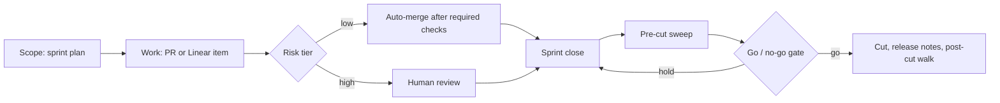

# Engineering playbook

How one small product team runs its codebase: how work is scoped, gated, reviewed, released, and handed between people and AI agents. This repo is the written policy, the checklists behind it, and three case studies that show the reasoning.

It is not a product. It contains no application code.

This is a builder's log. I set up this process while learning it, working with AI agents. The [builder log](builder-log.md) says what I built, what I got wrong, and what I am still learning.

## Who this is for

- Product, product-operations, and AI-product leads who want to see how decision records, release gates, and handoff checks work in practice.
- Engineering managers who want an example of risk-tiered merging and a written go/no-go rule.
- Anyone setting up agent-assisted work and needing a "what done looks like" check before work comes back to a person.

## Start here

| Read | When |
|---|---|
| [Case study 1: Release cut policy](case-studies/01-release-cut-policy.md) | You want to see how a cadence and a go/no-go rule were written, and why. |
| [Case study 2: Proof gate for handoffs](case-studies/02-proof-gate.md) | You want to see how "done" is checked before work reaches a decision maker. |
| [Case study 3: Risk-tiered auto-merge](case-studies/03-risk-tiered-merge.md) | You want to see how low-risk changes merge without a human and high-risk changes do not. |
| [Technical capabilities](technical-capabilities.md) | You want a list of what was built, with diagrams. |

## How the pieces fit

## Principles

1. **Write the standard before starting.** Each piece of work says what done looks like.
2. **Verify the premise.** Check the claim the work rests on before acting on it.
3. **Gates are checklists, not opinions.** Each gate line is checked and quoted.
4. **Count by state.** Every closeout reports closed, open, built but not wired, partially built, killed (with who decided), and fell off (named, never silent).
5. **Keep decisions in one place.** Decisions go to a single decision queue with one recommended option and a reason.

## Status and dates

Each document states the date it reflects. Policies here were written in early November 2026 and will change. Check the date at the top of each file before relying on it.

## Scope

The repo covers process only. Product code, customer data, metrics, and infrastructure details are kept out on purpose.
