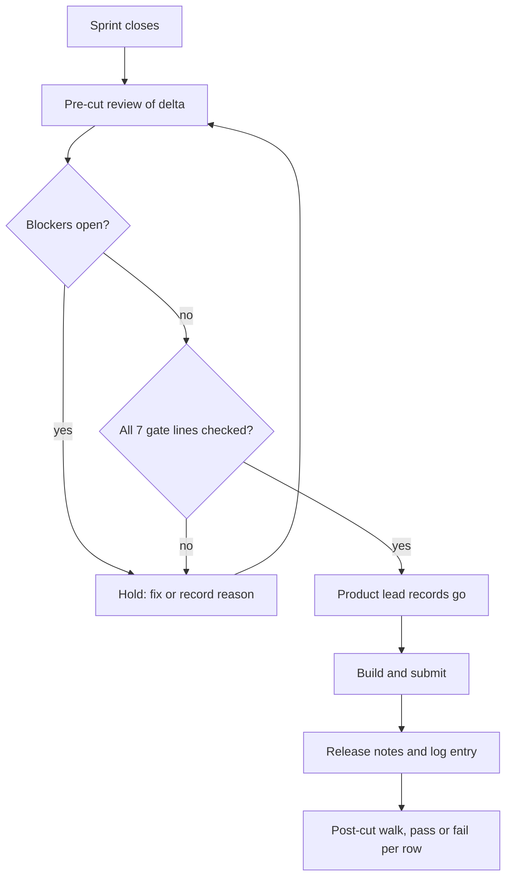

# Case study 1: A release cut policy for a small mobile team

**Date reflected:** early November 2026
**Context:** Volley, a consumer iOS app built by a small team with AI agents doing part of the work. Shipping was happening when someone decided, with no cadence and no written go/no-go rule.

## Problem

- No cadence. A build was cut when someone decided it should be.
- No written threshold for "cut" versus "hold". The go decision was a judgment in each report.
- Low-risk changes reached the main branch with no human walk, so each cut carried changes nobody had seen on a device.
- Sweep results were not linked to the cut state, so a missing sign-off could go unnoticed.

## Policy

**Cadence.** One cut every two sprints, at sprint close. The owner of cut mechanics runs it. The product owner sets the scope. The product lead makes the go call.

**Why every two sprints.** It fixed a date for the device walk. One cut per cycle was the alternative. It would have meant walking eight days of changes at once.

**Go / no-go.** A cut ships only when all of these hold, and each is checked and quoted on the cut report:

1. Type checks and automated checks pass on the exact commit being cut, and that commit is on main.
2. A pre-cut review of the changes since the last cut has zero unresolved blockers.
3. The cut has been walked in a simulator. Anything a simulator cannot exercise is listed, with an owner, and verified on a real device.
4. Every database migration in the cut is applied, or listed under "needs a decision". A migration not applied is never reported as done.
5. Every feature flag in the cut is off, or the flip has been approved.
6. The release log for the sprint is filled in.
7. The go decision is recorded on the cut report. An ambiguous "ok" is not a go.

**Release notes at every cut.** Each cut needs a notes file and a log entry before the build is submitted. Notes include a list of what was not walked.

**Post-cut walk record.** Every cut gets a dated walk. Every row gets a written pass or fail, even when it passes. Silence is not a result.

## Decision flow

## Trade-offs

- A two-sprint cadence means some fixes wait up to four days. The team accepted that to get a walk on a fixed date.
- Requiring every flag to be off at cut means some finished work waits for its flip. Half-built work stays on its branch and is not shipped dark.
- The checklist adds time to each cut. The aim is to make a hold cheap and visible, not to slow a clean cut.

## Quality before and after a release

**Before a release.** A bug fix counts as done only when its repro is shown failing on a build before the fix, and passing on the same build after it. A fix with no after-proof stays open. Anything the simulator cannot exercise is marked as needing a device check, and it is not counted as verified until a device run confirms it.

**After a release.** Every cut gets a dated walk record. Each row gets a written pass or fail, even when it passes. Silence is not a result. Any bug found after a cut is logged against that cut.

**Walk tiers.** Each change in a cut is tiered when it is merged, and the post-cut walk checklist lists the tiers automatically.
- **Tier 1, simulator walk:** any visible change on screen, and any flow that touches another person (borrow, ask, shared spaces). Stays open until walked.
- **Tier 2, device walk after the cut:** anything the simulator cannot exercise, such as gestures, camera, push, and sign-in codes. Listed as cannot be simmed. Stays open until walked on a device.
- **Tier 3, no walk:** copy-only, backend, feature-flagged-off, and documentation changes. Passing checks and a code read are enough.

Walks never block a merge. Tier 1 and Tier 2 items are tracked until they are walked, and a failed walk becomes a bug item (see [bug lifecycle](../bug-lifecycle.md)).

**Measures we track.** Bugs found after each cut, and reverts after low-risk merges. Both are reported from the record, not estimated.

## Result

<!-- Fill only with verified numbers from the cut reports. Do not estimate. -->
- Cuts with a recorded go decision: _to be filled from cut reports_
- Holds recorded with a reason: _to be filled from cut reports_
- Release notes present for every cut since adoption: _to be filled_

## What I would change

The cadence was set before the team had enough history to know what a cut usually contains. After a few cycles, look at the size of each cut and the number of holds, and adjust.

## Related

- Proof gate for handoffs: [case study 2](02-proof-gate.md)
- Risk-tiered merging: [case study 3](03-risk-tiered-merge.md)
