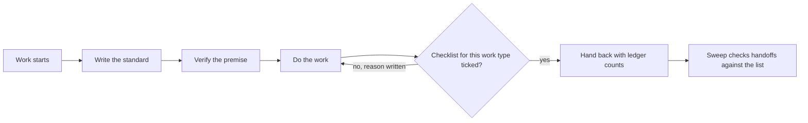

# Case study 2: A proof gate for work handed between people and agents

**Date reflected:** 2 November 2026
**Context:** Volley. Work is done by a mix of people and AI agents. Each agent has a role and an owner. Results come back to a single decision maker.

## Problem

Work kept coming back half-finished, or the same question was asked twice. The team already had a roster of owners and a set of tools, but nothing checked whether a piece of work was actually done before it was handed back.

## Policy

Before any agent hands work to the decision maker or posts a result, it ticks the checklist for that kind of work. The result carries the ticked list. If a line cannot be ticked, the reason is written next to it.

The gate applies the same way to every work type:

1. **Standard first.** Before starting, write one line: what done looks like.
2. **Verify the premise.** Check the claim the work rests on with a query, a read, or a run. Quote what was checked.
3. **Links, always.** Every pull request, task, document, and page named is a link.
4. **Ledger.** Report counts by state.
5. **Never re-ask.** If the decision maker already picked an option, pass the pick on. Do not ask again.

Checklists exist for a pull request, a design frame, a task item, a device or ops step, a document, and a decision request. Each has its own short list.

## Example checklist: pull request

- [ ] Task ID in the title and body, or a reason there is none.
- [ ] Risk label set by the pipeline, not by the author.
- [ ] Assignee and reviewer set.
- [ ] "How it was checked" names what ran, and what is still unverified.
- [ ] Premise verified and quoted in "Why".
- [ ] Required checks green, or the failure named with a link.
- [ ] Nothing skipped, disabled, or quarantined to get green.

## Flow

A scheduled sweep compares open handoffs against the checklist and flags any handoff that skipped it. The flags go to the coordinating agent.

## Trade-offs

- Checklists add a few minutes to each handoff. The team judged that cheaper than a second round of questions.
- A checklist can be ticked falsely. The sweep and the quoted evidence are the check against that, not the tick itself.

## Result

<!-- Fill only with verified counts from the sweep reports. Do not estimate. -->
- Handoffs flagged by the sweep, by week: _to be filled from sweep reports_
- Repeat questions to the decision maker: _to be counted, not estimated_

## What I would change

Keep the checklists short. A long checklist gets skipped. Start with the three work types that cause the most rework, and add more only when a gap shows up.

## Related

- Release cut policy: [case study 1](01-release-cut-policy.md)
- Risk-tiered merging: [case study 3](03-risk-tiered-merge.md)
