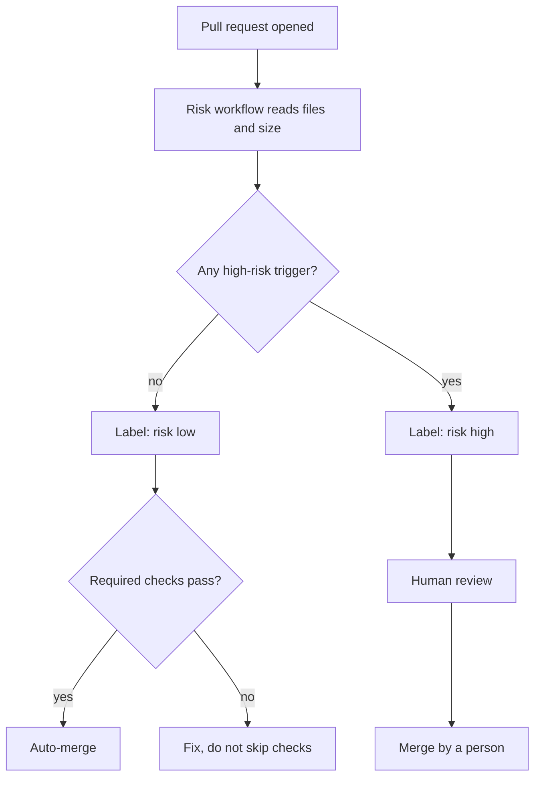

# Case study 3: Risk-tiered auto-merge

**Date reflected:** 2 November 2026
**Context:** Volley. Pull requests come from people and from AI agents. Most changes are small. A few touch data, security, or money.

## Problem

Every pull request waited for a human, even trivial ones, so the review queue grew. But auto-merging everything would let a risky change land unseen. The team needed a rule that sorts changes by risk and merges only the safe ones.

## Policy

A workflow labels each pull request by risk from its changed files and size.

**Low risk** merges automatically once all required checks pass.

**High risk** waits for a human review. A change is high risk if it:

- changes a database migration,
- changes access rules or authentication,
- changes the deployment or CI workflows,
- changes secrets or environment settings,
- changes payments,
- changes server functions or infrastructure,
- changes dependency manifests or lock files,
- is larger than 300 lines or touches more than 10 files, or
- comes from a fork.

**Medium risk** (in review, not yet live) is a change that is not high risk but touches application code. An agent merges it after the pre-cut sweep, not automatically, so it gets a second look before it reaches the release cut.

The author does not set the risk label. The workflow does, so the label cannot be talked down.

## Flow

## Rules that go with it

- Never skip, disable, or quarantine a test to get green.
- Never merge a high-risk change automatically.
- A pull request opens as a draft until it has been walked on a device if it changes a screen.
- Dependency bumps from automated tools are reviewed under the same tiers. Lock-file changes are high risk.

## Trade-offs

- Low-risk changes reach the main branch with no human look. The cut review has to cover them, which is why the release policy requires a walk of the cut.
- The size thresholds are blunt. A large generated change can be high risk for size alone, which is intended but occasionally annoying.
- A keyword or path rule can miss a risk. The list is reviewed when a change slips through.

## Result

<!-- Fill only with verified counts from the workflow runs. Do not estimate. -->
- Pull requests labelled low and high, by month: _to be counted from workflow labels_
- High-risk changes that needed a human review and got one: _to be counted_

## What I would change

Add a check that reads the changed files from the dependency and lock-file list, not just from the path. Also measure how often a low-risk change needs a revert. That number is the honest test of the rule.

## Related

- Release cut policy: [case study 1](01-release-cut-policy.md)
- Proof gate: [case study 2](02-proof-gate.md)
