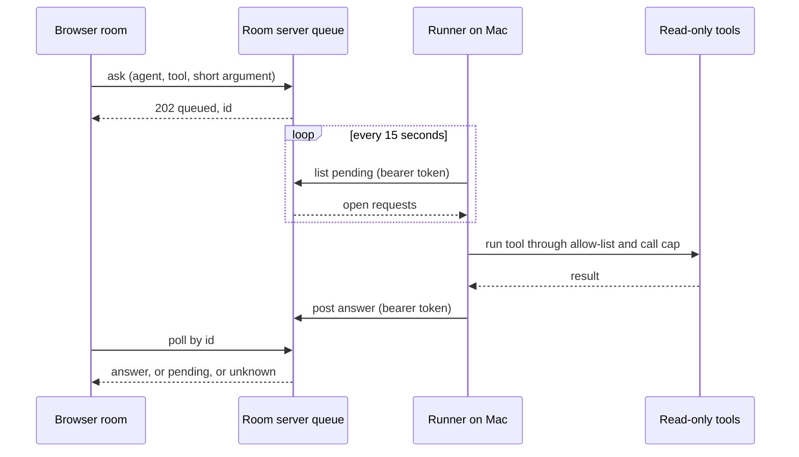

# Case study 4: A meeting room where agents answer with real tools, and a queue that lets a browser reach them

**Date reflected:** 2 November 2026
**Context:** Volley. A small team runs a shared "meeting room" web page where people and AI agents (one per role: product, design, engineering, growth, and so on) talk through a question together. The agents need live data to answer well. The room is hosted on Cloudflare; the agent runner is a background job on one person's Mac.

## Problem

Two things were true at once:

1. The agents answered from memory unless someone pasted numbers into the chat. The answers were fluent and often stale.
2. The browser room could not call the Mac directly. The Mac sits behind a home network, has no public address, and should not open a port to the internet just so a web page can ask it a question.

The team needed a way for the room to ask for a small set of read-only facts, have the runner fetch them with the same limits used elsewhere, and get the answer back, without giving the browser or the internet any way into the Mac.

## Policy

Three pieces, each with a narrow job.

**1. Room runner (Mac background job).** A small Node process started by macOS launch agent. It has two intake paths:

- *Ask room.* Every five minutes it reads open issues that carry a label, answers up to three new ones using files an agent is allowed to read, and writes each answer to a local log. It has read-only access to the tracker and never writes back.
- *Browser bridge.* Every 15 seconds it asks the room's server for open tool requests, runs each one, and posts the answer back.

**2. Tool allow-list and call cap.** Tools are read-only: a read-only analytics query, a tracker search, a pull request list, a tracker read, and a few team-specific briefs. Each agent sees only the tools on its own list. Tools are off unless an explicit flag is set in the job's own configuration, and the runner records that flag on every heartbeat so a restart with tools silently off is visible. A call past the cap returns a refusal, and the answer names the tool that did not run. Both intake paths go through the same function, so the rules cannot drift apart.

**3. Outbound queue on the room server.** The browser asks the server to queue a request and then polls for the answer. The runner polls the server for pending requests and posts answers back. Requests and answers live in a key-value store and expire after ten minutes. The Mac opens no port and holds no tunnel. Every request is checked against a fixed list of agent names and tool names before it is stored, and the answer size is capped.

Auth is split by direction:

- Browser routes sit behind the team's access gate, like every other route on the room host.
- Runner routes use a bearer token that lives in the server's secret store, and they fail closed. No token configured, no header, or a wrong token all get a refusal.
- The runner's routes need a bypass in the access gate, because the Mac has no browser session. That bypass covers only the runner prefix.

## Flow

## Two lessons from the same week

**Declare bindings in code, not only in the dashboard.** The queue needed a key-value binding on the server. It had been added in the hosting dashboard. The next deploy from the configuration file dropped it, because the file did not know about it, and the queue went dark without a clear error. The fix was to declare the binding in the configuration file so every deploy keeps it. The rule to take from it: if a resource must survive deploys, it lives in the code that deploys.

**Narrow, per-command allow rules let agents deploy without a person doing each step.** Deploys were a hand-off every time: an agent prepared a change, a person ran the deploy command, then the agent checked it. The fix was an allow rule that covers one exact command and one exact target, added once by the person who owns the machine. After that, an agent could run that single deploy from a reviewed commit. It cannot run a wider command, and a merge still needs a person. The rule is written as the narrowest command that does the job, and it is reviewed when a new deploy target is added.

## Rules that go with it

- Tools are read-only. A tool that writes is a separate decision with its own review.
- An agent gets only its own tools. The cap is applied per request, so a long answer cannot pile up calls.
- The runner writes an audit line for every tool call: which agent, which tool, how many characters in and out. Write arguments are logged only for the one write tool, truncated.
- Secrets are never in the code, the room page, or the chat. They live in the Mac's keychain and the server's secret store.
- A change to what the runner can reach should get the same review as a change to access rules: high risk, with a human on it.

## Trade-offs

- A poll every 15 seconds is simple and works through a home network, but it adds up to 15 seconds of wait per answer. A push channel would be faster and would need a port or a tunnel, which the team chose not to run.
- The queue expires after ten minutes. A slow answer is lost, and the browser shows "unknown". That is acceptable for read-only lookups and would not be for writes.
- The per-request cap is simple to reason about, but it does not limit how many requests an agent can make in total. The runner's own schedule does.
- Running the runner on a personal Mac means it is up only when that Mac is awake and the job is loaded. That is a real availability limit, and the heartbeat is how it is checked.

## Result

<!-- Fill only with verified results from the runner logs and the room's own checks. Do not estimate. -->
- First live bridge round trip (request, runner poll, answer back to the browser): verified once, about 34 seconds end to end. The audit log recorded the tool event.
- One tool did not work in that run: the GitHub pull request tool answered "not connected", because the runner does not have GitHub wired up yet. The bridge carried the answer; the tool itself is not yet live.
- Tool calls by tool and agent, by week: _to be counted from the audit log_
- Requests that expired unanswered: _to be counted from the queue, not estimated_

## What I would change

Measure before adding tools. Each new tool adds a row to an allow-list and a line in the audit log, and the team should know which tools are used before adding more. Also add a check that fails the deploy when a binding declared in the dashboard is missing from the code. The check would have caught the dropped binding before it reached users.

## Related

- Release cut policy: [case study 1](01-release-cut-policy.md)
- Proof gate: [case study 2](02-proof-gate.md)
- Risk-tiered merging: [case study 3](03-risk-tiered-merge.md)
