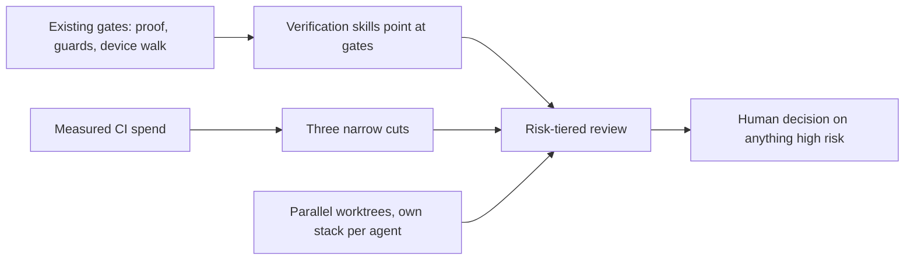

# Case study 5: Agent workflow skills, CI spend, and parallel work

**Date reflected:** 3 November 2026
**Context:** Volley. A small team where people and AI agents share the same codebase. In one day the team added a verification skill set, a single code-quality command, a cost cut to CI, a design for an error-fix loop, and scripts for running agents in parallel.

## Problem

The process grew faster than the team could check it. Each piece was sound on its own, but the risk was that new tools would be added before anyone ran them, and that the checks they relied on would go unrun.

## Policy

Three rules, written down before the work began.

1. **Each skill points at a gate that already exists.** The verification skills cite the proof gate, the guard scripts, and the device walk. They do not invent a new process. A skill that repeats a gate is a copy that can drift, so it names the source instead.
2. **Spend is a decision, not a side effect.** CI cost was measured first, from a sample of recent runs, and then cut in three narrow places. Docs-only changes skip the slow lanes. Superseded analyses are cancelled. Label jobs run on the events that need them, not on every push.
3. **Parallel work gets its own stack.** Each agent gets its own worktree and its own local database port block, and the port changes are kept out of version control. A script refuses rather than guessing when state is unclear.

Third-party skills are credited and installed separately under their own licenses. Nothing is copied into the repo. The one command that bundles several review passes names each upstream skill and reports any that are missing.

## Flow

## Trade-offs

- A set of small skills is easier to check than one large one, but it adds names to remember. The single command bundles the review passes for that reason.
- Cutting CI lanes saves money on docs-only changes. The risk is a skipped lane that should have run. The check is to confirm the first real docs-only change after the cut, and to say so until that happens.
- Upstream tools are third-party, so their behaviour can change. Pinning and reviewing them is still manual.

## Upstream credit

- pstack, by Lauren Tan (MIT), from the cursor/plugins repository.
- thermos (MIT, Copyright 2026 Cursor), from the cursor/plugins repository.
- ponytail (MIT, Copyright 2026 DietrichGebert).

## Result

<!-- Fill only with verified results. Do not estimate. -->
- Verification skills run in a live session: _not yet; the scripts they cite were checked to exist, nothing more_
- Docs-only change reports green with the slow lanes skipped: _to be confirmed on the first such change_
- Two parallel agents with separate database stacks on one machine: _to be verified with a real stack_

## What I would change

Run each skill once on a real change before calling it done. Measure CI spend again after two weeks. Keep the upstream list short, and review it when a tool updates.

## Related

- Proof gate: [case study 2](02-proof-gate.md)
- Risk-tiered merging: [case study 3](03-risk-tiered-merge.md)
- Meeting room bridge: [case study 4](04-meeting-room-agents-and-bridge.md)
