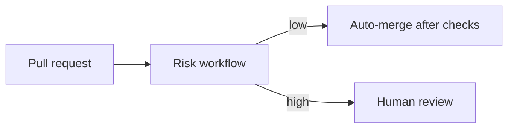
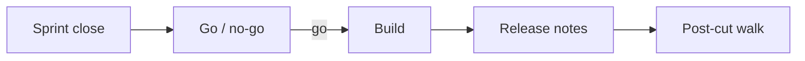
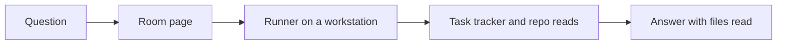

# Technical capabilities

What was built and shipped by the author, described without code. Each item lists the problem, what was built, and the evidence (counts or pull-request numbers in a private repository). The product code is private. Links to private pull requests are omitted here.

Date reflected: 2 November 2026.

## Summary

| Area | What was built | Evidence |
|---|---|---|
| Delivery pipeline | Risk-tiered labelling and auto-merge for low-risk pull requests | Workflow added and tuned in the first two days of November 2026 |
| Quality gates | Automated accessibility check on public pages in CI; unit-test scaffold | Pull requests in early November 2026 |
| Security baseline | Dependency scanning, code scanning, and a security policy file | Baseline merged in early November 2026 |
| Data handling | Retry and purge queue for third-party analytics deletions, with privacy-safe status reporting | Several merged fixes, including a queued purge that runs hourly |
| Agent operations | Agent work log that records merged pull requests automatically | Merged in late October 2026 |
| Team operations | Operating flow, roster, cycle-driven planning, release log template | Documents merged late October to early November 2026 |
| Internal tools | A meeting room with agent-answered questions, backed by a task-tracker feed | Built and in use; deployment still being verified |
| Cost control | Model routing table for routine versus data-heavy questions | Merged in early November 2026, checked by unit tests only |

## 1. Delivery pipeline: risk-tiered merging

**Problem.** Routine changes waited on a human, and the queue grew.

**Built.** A workflow that reads each pull request's changed files and size, labels it low or high risk, and auto-merges low-risk changes once required checks pass. High-risk changes wait for review.

**Evidence.** Workflow merged, then tuned to keep lock-file and dependency changes high risk.

## 2. Quality gates in CI

**Built.** An accessibility check runs on the signed-out public pages in CI, and a unit-test scaffold with a first test was added. A deploy is refused when a required analytics key is missing.

**Evidence.** Merged in late October to early November 2026.

## 3. Release and cut process

**Built.** A written cadence, a go/no-go checklist, release-notes requirements, and a post-cut walk record. Written up as [case study 1](case-studies/01-release-cut-policy.md).

## 4. Analytics deletion queue

**Problem.** Deletion requests sent to a third-party analytics service could fail silently. Each failure needed to be retried and reported honestly.

**Built.** A queue that keeps failed deletions, retries them, and reports the true state to the user. An hourly job drains the queue. The status message was rewritten so it never claims a deletion happened when it did not.

**Evidence.** Several merged fixes across early November 2026.

## 5. Agent work log and operating flow

**Built.** A log that records merged pull requests automatically, and a written operating flow that sets out who owns what among people and agents.

**Evidence.** Merged late October 2026. Documents linked from the roster.

## 6. Internal meeting room

**Built.** A room where a team member can ask a question in plain language and get an answer that comes from the task tracker and the repository. Answers are logged with the files that were read.

**Status.** Built and in use. The last live check is still open, so this is listed as partly verified.

## 7. Model routing and cost control

**Built.** A rule that sends routine questions to a smaller, cheaper model and sends questions with numbers or status to a larger one. Each call sets a read budget. The rule is written as a table in the policy.

**Evidence.** Merged early November 2026. Checked by unit tests only, so live behaviour is still being verified.

## Not shown here

Product code, data models, infrastructure details, customer information, and any internal metrics are not shown in this repo on purpose.
