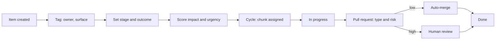

# Triage and tagging

How work is labelled so people and agents can sort it the same way. This page shows the system with generic names. Real outcome names, team members, and issue titles are left out.

Date reflected: 2 November 2026.

## Taxonomy

| Dimension | Where it lives | Values (generic) | Who sets it | Purpose |
|---|---|---|---|---|
| Impact | Team tracker | Score 1 to 5 | Owner of the item, reviewed in the weekly sweep | How much the item moves the product goal |
| Urgency | Team tracker | Score 1 to 5 | Owner of the item | How soon it must happen |
| Stage | Task tracker label | Discover, Validate, Build, Launch, Evaluate, Iterate | Owner of the item | Where the work sits in the product loop |
| Outcome | Task tracker label | Outcome 1 to Outcome 6 | Owner of the item | Which product goal the work serves |
| Surface | Task tracker label group | App, Landing, Journal, Web app (untagged means App) | Set at creation | Which part of the product changes |
| Owner | Task tracker label | One owner label per item | Set at creation | Who is accountable for the item |
| Chunk | Task tracker label | Chunk 1, Chunk 2, Chunk 3 | Planning owner | Which block of the cycle the item belongs to |
| Type | Pull request body line | bug, feature, chore | Author | Sets the type label |
| Risk | Pull request label | low, high | Pipeline only | Decides auto-merge |

## Rules

1. **One owner per item.** Each item has exactly one owner label. Agents share one tracker account, so the assignee field never means an agent. Ownership is only the owner label.
2. **Tag at creation.** Surface and owner are set when the item is created, not later.
3. **Stage and outcome are required** before an item moves to In Progress.
4. **Status matches reality.** An item is closed only when its pull request is merged or its decision is recorded.
5. **Risk is never set by the author.** The pipeline sets it from the changed files and size. See [case study 3](case-studies/03-risk-tiered-merge.md).
6. **Impact and urgency are ratings, not promises.** They are reviewed in the sweep, and the reasoning is written next to the score.

## Diagram: how an item moves through the labels

## Example entries (generic)

| Item | Owner | Surface | Stage | Outcome | Chunk | Impact | Urgency |
|---|---|---|---|---|---|---|---|
| Fix a crash on one screen | Engineering | App | Build | Outcome 2 | Chunk 1 | 4 | 5 |
| Explore a new sharing idea | Product | Web app | Discover | Outcome 4 | Chunk 3 | 3 | 2 |

## Git tagging

| Label | Values | Set by |
|---|---|---|
| `type: bug`, `type: feature`, `type: chore` | from the body line | pipeline |
| `risk: low`, `risk: high` | from changed files and size | pipeline |
| Linked item ID in title and body | required | author |

## Not disclosed

Real outcome names, the impact and urgency scores of real items, team member names, and issue titles are not in this page on purpose.
